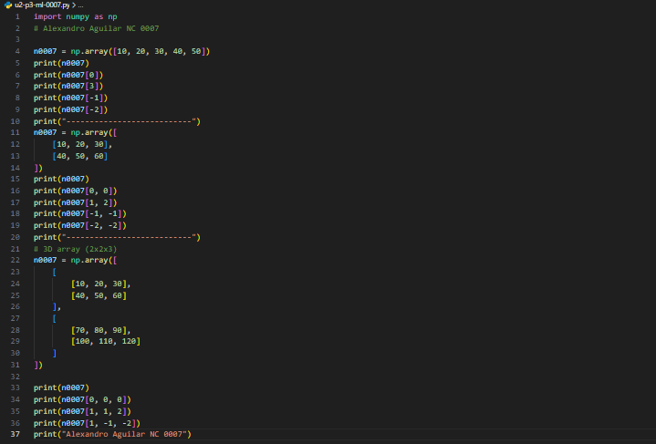
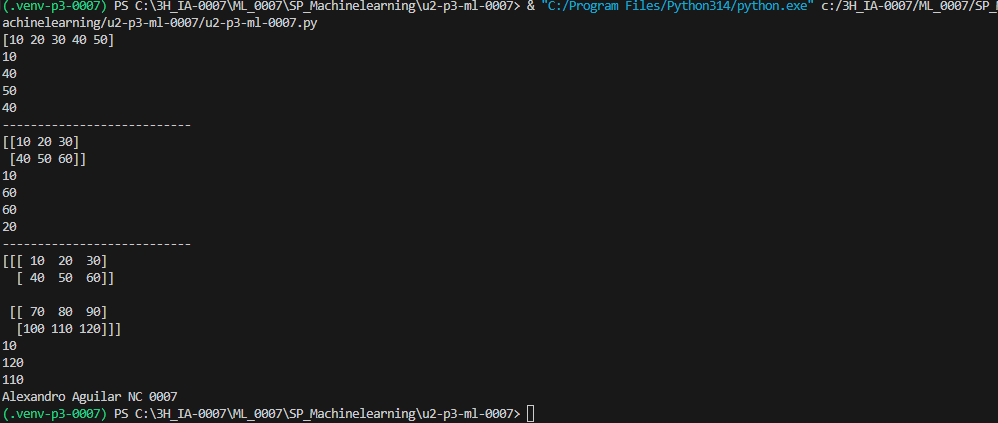

## Explicacion 
- [10, 20, 30, 40, 50]: Son los elementos que se guardan dentro del arreglo.
- n0007[0]: Accede al primer elemento del arreglo, que es 10. Los índices comienzan en 0.
- n0007[3]: Accede al cuarto elemento del arreglo, que es 40.
- n0007[-1]: Accede al último elemento del arreglo, que es 50.
- n0007[-2]: Accede al penúltimo elemento del arreglo, que es 40. Los índices negativos permiten contar desde el final.

## El codigo

## resultado
